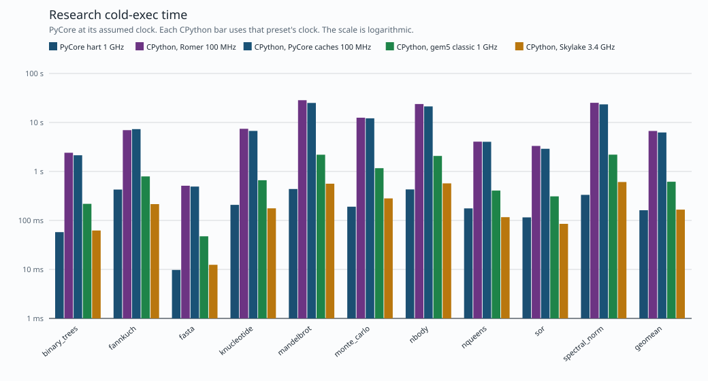

# CPython research benchmarks across machines

Cold-exec time for the research set. PyCore is the measured hart. Every other series is CPython 3.14 under the simple-core model (`cpython_baseline`) at that preset's own clock, so a faster clock is part of the machine. The same cycle counts are in the table.

Regenerate with `make research-compare-machines`.

Recorded 2026-10-12 21:17 UTC.

## Geometric mean

| machine | clock | programs | geomean cycles | geomean time |
| --- | ---: | ---: | ---: | ---: |
| PyCore hart 1 GHz | 1000 MHz | 10 | 13,584,692 | 13.58 ms |
| CPython, Romer 100 MHz | 100 MHz | 10 | 53,013,237 | 530.13 ms |
| CPython, PyCore caches 100 MHz | 100 MHz | 10 | 49,257,794 | 492.58 ms |
| CPython, gem5 classic 1 GHz | 1000 MHz | 10 | 48,427,971 | 48.43 ms |
| CPython, Skylake 3.4 GHz | 3400 MHz | 10 | 43,798,561 | 12.88 ms |

## Cold exec, per program

| program | PyCore hart 1 GHz | CPython, Romer 100 MHz | CPython, PyCore caches 100 MHz | CPython, gem5 classic 1 GHz | CPython, Skylake 3.4 GHz |
| --- | ---: | ---: | ---: | ---: | ---: |
| binary_trees.py | 10.75 ms (10,747,022) | 447.69 ms (44,769,141) | 401.46 ms (40,146,092) | 40.43 ms (40,432,898) | 11.59 ms (39,421,600) |
| fannkuch.py | 50.60 ms (50,604,450) | 823.55 ms (82,355,086) | 810.51 ms (81,050,672) | 86.80 ms (86,804,250) | 23.67 ms (80,463,321) |
| fasta.py | 7.18 ms (7,182,614) | 319.83 ms (31,982,506) | 321.38 ms (32,138,262) | 30.98 ms (30,980,562) | 8.17 ms (27,772,520) |
| knucleotide.py | 16.43 ms (16,434,590) | 581.64 ms (58,164,229) | 524.48 ms (52,448,196) | 52.14 ms (52,137,579) | 13.80 ms (46,914,055) |
| mandelbrot.py | 11.18 ms (11,176,958) | 728.84 ms (72,884,240) | 647.13 ms (64,712,633) | 57.51 ms (57,513,590) | 14.49 ms (49,273,841) |
| monte_carlo.py | 9.55 ms (9,554,830) | 625.04 ms (62,504,171) | 612.15 ms (61,214,933) | 58.64 ms (58,640,581) | 14.15 ms (48,103,385) |
| nbody.py | 4.39 ms (4,386,404) | 248.20 ms (24,820,121) | 216.73 ms (21,672,984) | 21.50 ms (21,496,511) | 5.88 ms (19,991,958) |
| nqueens.py | 55.07 ms (55,074,898) | 878.28 ms (87,828,292) | 850.68 ms (85,067,765) | 84.78 ms (84,777,738) | 21.90 ms (74,462,313) |
| sor.py | 15.70 ms (15,698,642) | 473.25 ms (47,324,550) | 415.95 ms (41,595,489) | 42.51 ms (42,511,945) | 11.69 ms (39,754,371) |
| spectral_norm.py | 8.23 ms (8,232,062) | 543.92 ms (54,392,389) | 504.68 ms (50,468,495) | 47.90 ms (47,897,985) | 13.18 ms (44,810,431) |

Each cell is simulated time at that machine's clock, then the cycle count.
Time is cycles / clock. A smaller bar is a faster machine.
